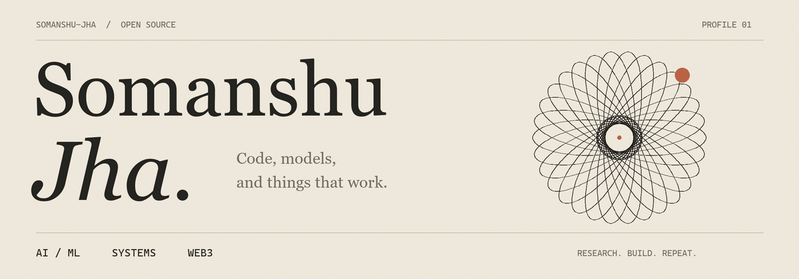
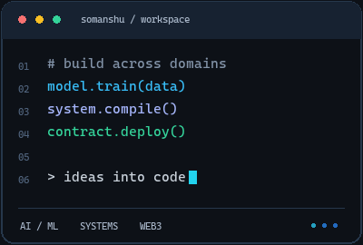

  <picture>
    <source media="(prefers-reduced-motion: reduce)" srcset="./assets/banner.png" />
    
  </picture>

<h1 align="center">Hi, I'm Somanshu Jha</h1>
<h3 align="center">AI / ML · Backend · Systems · Web3</h3>

I work across machine learning, backend development, automation, systems programming, and blockchain.

  
  

## About me

<picture>
  <source media="(prefers-reduced-motion: reduce)" srcset="./assets/building.png" />
  
</picture>

- **AI / ML:** Deep learning, NLP, computer vision, and scientific computing.
- **Backend & automation:** APIs, full-stack development, and Linux automation.
- **Systems:** Low-level programming, GPU computing, and infrastructure.
- **Web3:** Smart contracts, blockchain development, and Starknet.

Find my work in the projects below, or explore my repositories on GitHub.

 

## Languages

#### AI, scientific computing & GPU programming

  
  
  
  
  

#### Systems, backend & infrastructure

  
  
  
  
  
  
  
  
  
  

#### Web & cross-platform development

  
  
  

#### Smart contracts & blockchain

  
  
  

View all language domains

| Language | Primary domain |
| --- | --- |
| Python | AI/ML, Backend, Automation |
| C | Systems Programming |
| C++ | DSA, Systems, AI |
| JavaScript | Web Development |
| TypeScript | Full-Stack Development |
| Java | Backend Development |
| Rust | Web3, Blockchain, Systems |
| Solidity | Smart Contracts |
| Cairo | Starknet Development |
| Go (Golang) | Cloud, Backend, Infrastructure |
| R | Statistical Computing |
| Julia | Scientific Computing |
| SQL | Database Management |
| Bash | Linux Automation |
| Move | Blockchain Development |
| HCL | Infrastructure as Code |
| CUDA | GPU Programming |
| Assembly | Low-Level Programming |
| Mojo | AI & High-Performance Computing |
| PHP | Backend Development |
| Dart | Cross-Platform Development |

## Frameworks & libraries

#### Machine learning & optimization

  
  
  
  
  
  
  
  
  
  

#### NLP, LLMs & generative AI

  
  
  
  
  
  

#### Computer vision

  
  
  
  
  
  

#### MLOps & distributed computing

  
  
  
  
  
  

View all framework purposes

| Framework / library | Purpose |
| --- | --- |
| TensorFlow | Machine Learning |
| PyTorch | Deep Learning |
| Keras | Neural Networks |
| Scikit-learn | Classical ML |
| XGBoost | Gradient Boosting |
| LightGBM | Gradient Boosting |
| CatBoost | Machine Learning |
| JAX | High-Performance ML |
| ONNX | Model Interoperability |
| MLflow | ML Lifecycle Management |
| Kubeflow | ML Pipelines |
| Ray | Distributed Computing |
| H2O.ai | Automated ML |
| Optuna | Hyperparameter Optimization |
| Weights & Biases | ML Experiment Tracking |
| DVC | Data Version Control |
| Hugging Face Transformers | NLP & LLMs |
| Hugging Face Diffusers | Generative AI |
| OpenCV | Computer Vision |
| MediaPipe | Computer Vision |
| Ultralytics YOLO | Object Detection |
| Detectron2 | Object Detection |
| MMDetection | Computer Vision |
| Albumentations | Image Augmentation |
| NLTK | NLP |
| spaCy | NLP |
| Gensim | NLP |
| Sentence Transformers | Embeddings |

## Featured projects

| Project | Focus |
| --- | --- |
| [AI-Accelerated Reading Platform](https://github.com/Somanshu-Jha/AI-Accelerated-Reading-Platform) | AI-assisted blog discovery, reading, and visualization. |
| [Crop Yield Prediction](https://github.com/Somanshu-Jha/crop-yield-prediction1) | Crop yield prediction project. |
| [PitchPerfect](https://github.com/Somanshu-Jha/PitchPerfect) | An AI-based tool for improving pitches. |
| [My Portfolio](https://github.com/Somanshu-Jha/My-PortFolio) | My portfolio project. |

## GitHub activity

  
  

  

Language statistics reflect repository code composition, not proficiency. Activity cards are provided by external services.

  <a href="https://github.com/Somanshu-Jha?tab=repositories">Explore my repositories</a> · <a href="https://github.com/Somanshu-Jha?tab=followers">Connect on GitHub</a>

